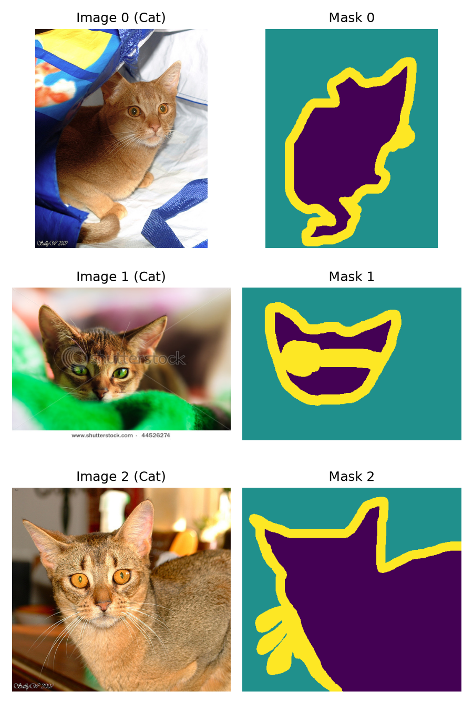
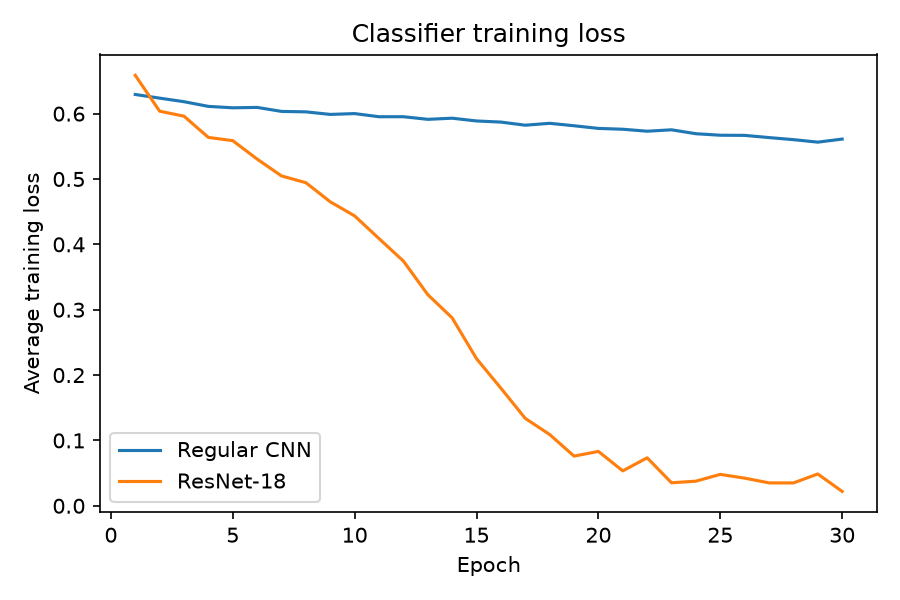
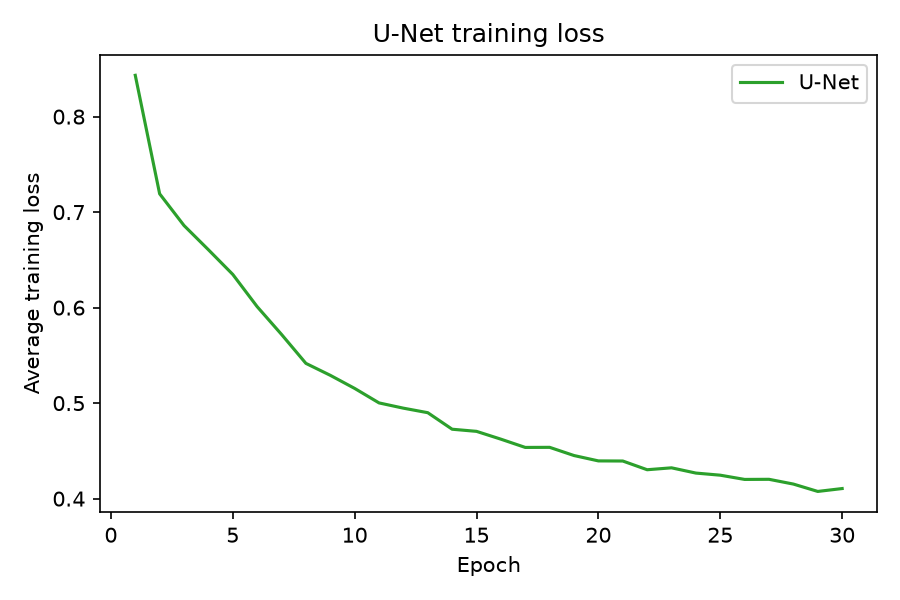
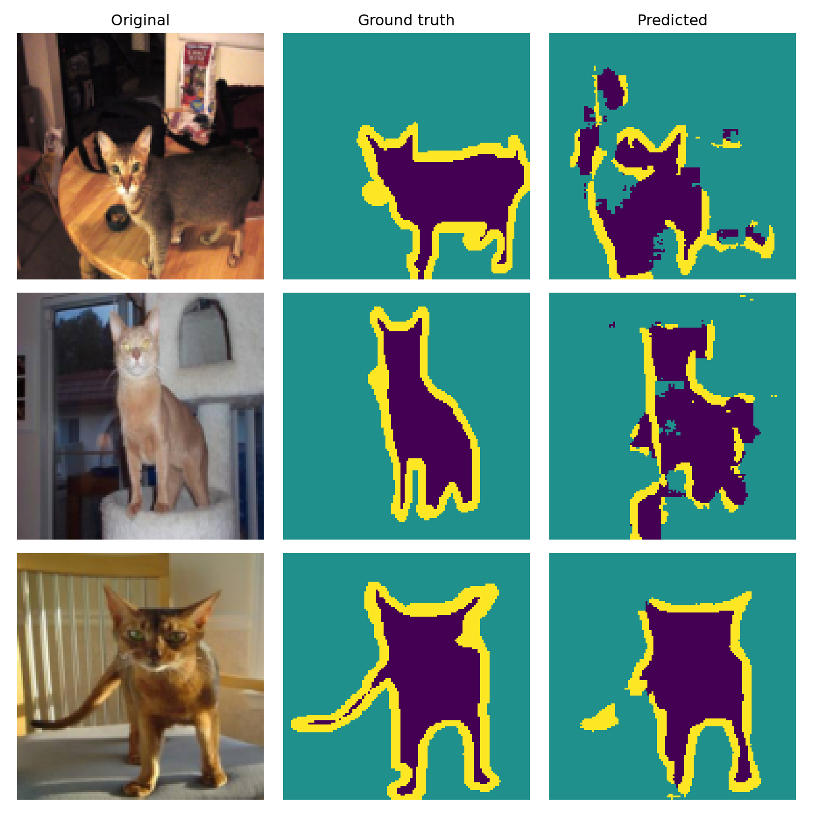

# Image Classification and Segmentation with PyTorch (Oxford-IIIT Pet Dataset)

An end-to-end deep learning project implementing, training, and evaluating three PyTorch models on the Oxford-IIIT Pet dataset: a baseline 3-layer Convolutional Neural Network (CNN), a ResNet-18, and a small U-Net for pixel-level segmentation. There are three python files, I implemented them using Claude, the first is models.py,which defines the three networks. Nothing in this file trains the models. Then there is train.py which imports the models, trains each one at a time and then saves the weights to a .pt file. Additionally saving the per-epoch losses to a .json file. The last file is called evaluate.py which loads the saved weights and the test data, it computes accuracy and pixel accuracy and makes the plots. It never trains, which is why you can rerun it almost instantly.

---

## Section 1: Setup, Run Instructions, and Settings

### Install and run

```powershell
# Create and activate a virtual environment NOTE you must be in this environment to run the code 
python -m venv venv
venv\Scripts\Activate.ps1

# Install dependencies, if you don't already have them installed of course make sure to DOUBLE CHECK!!!! We don't want to make a mess of the environment
pip install -r requirements.txt

# Download and extract the dataset into data/oxford-iiit-pet/    this loads the data(images) and masks and batchs
python data.py

# Run the pipeline, run each line individually please it might cause issues if they are all run at once
python explore.py                          # Part 1: dataset info, sample figure, batch shapes
python models.py                           # optional but it best to run it before hand to ensure its working: shape sanity check for all three models
python train.py --model cnn --epochs 30    # Part 2: train the CNN
python train.py --model resnet --epochs 30 # Part 2: train ResNet-18
python train.py --model unet --epochs 30   # Part 2: train the U-Net
python evaluate.py                         # Parts 3 and 4: metrics, plots, segmentation figure
```

Run all commands from inside this folder (assignment4). On Windows, the default `pip install torch` gives a CPU-only build. So I trained with the CUDA 12.8 build:
`pip install torch torchvision --index-url https://download.pytorch.org/whl/cu128`

### Hardware and software
Trained on GPU (NVIDIA GeForce RTX 3070 Laptop GPU, CUDA 12.8 build of PyTorch) with Python 3.14. Each epoch took about 18 s for every model, mostly because of image loading. I have a this gpu on my local machine its best to check which gpu you have to ensure it works with cuda or torch.

### Architectures
- **Regular CNN** (23,714 parameters): Conv(3→16) → ReLU → MaxPool → Conv(16→32) → ReLU → MaxPool → Conv(32→64) → ReLU → AdaptiveAvgPool(1×1) → Flatten → Linear(64→2).
- **ResNet-18** (11,177,538 parameters): `torchvision.models.resnet18(weights=None)` with `fc` replaced by `Linear(512, 2)`; all parameters trainable.
- **Small U-Net** (117,075 parameters): encoder DoubleConv(3,16) → pool → DoubleConv(16,32) → pool → bottleneck DoubleConv(32,64); decoder ConvTranspose(64→32) + skip from E2 → DoubleConv(64,32) → ConvTranspose(32→16) + skip from E1 → DoubleConv(32,16) → 1×1 Conv(16→3). Skip connections use `torch.cat(dim=1)`.

### Training settings
| Setting | Value |
|---|---|
| Optimizer | Adam (separate optimizer per model) |
| Learning rate | 0.001 |
| Loss | CrossEntropyLoss (raw logits) |
| Batch size | 16 |
| Epochs | 30 for all three models (chosen for feasible training time) |
| Random seed | `torch.manual_seed(0)` before each model is built |
| Initialization | Random, no pretrained weights |

The CNN and ResNet-18 use identical training budgets. No hyperparameters were tuned, and no test results were used to choose any setting.

---

## Section 2: Results and Analysis

### Dataset information
- Training samples: 3680 (1188 cat, 2492 dog). Test samples: 3669 (1183 cat, 2486 dog).
- First training image: 394 × 500 (width × height), label 0 (Cat). Its mask is also 394 × 500, with unique values [1 2 3].
- Original masks use 1, 2, 3. The loaders convert them to 0 = pet, 1 = background, 2 = boundary.



In the mask images, purple = pet, teal = background, yellow = boundary (viridis colormap).

### Processed batch shapes
- `images`: `[16, 3, 128, 128]`
- `labels`: `[16]`
- `masks`: `[16, 128, 128]`

### Classification accuracy
| Model | Test accuracy |
|---|---|
| Regular CNN | 0.7037 |
| ResNet-18 | 0.7735 |
| Majority baseline (always Dog) | 0.6776 |

### U-Net pixel accuracy
Pixel accuracy: **0.8337**. Per class: pet 79.5% correct (30.0% of pixels), background 94.1% (57.7%), boundary 42.2% (12.3%). Could potentially be better if we trained the u-net with more epochs, but recall we ran only with 30, python train.py --model unet --epochs 30, for me this test took about 20-30 minutes unfortunately so I don't want to raise the amount.

### Training losses



### Segmentation examples


### Analysis

**Classification.** ResNet-18 performed better, beating the CNN by about 7.0 percentage points (0.7735 vs 0.7037). Both beat the always-Dog baseline of 0.6776: ResNet-18 by about 9.6 points, the CNN by only about 2.6, so the CNN learned little beyond the class imbalance. In this experiment the more complex model did perform better. However, ResNet-18's training loss fell to about 0.02 while its test accuracy is only 77%, which suggests it overfit the 3680 training images. Both numbers come from one run with one seed, so I would not read much into small differences. 

**Training losses.** The CNN loss decreased almost linearly but slowly, from 0.629 at epoch 1 to 0.561 at epoch 30, with small fluctuations along the way (for example, it rose slightly at epochs 6, 10, 14, and 18). It had not leveled off by epoch 30 (its a lot less volatile). ResNet-18's loss started at 0.659 and dropped steeply, reaching about 0.08 around epoch 19. After that it became somewhat volatile (small rises at epochs 20, 22, and 25) before settling near 0.02 at epoch 30. The U-Net loss fell quickly in early epochs (0.843 to about 0.50 by epoch 11) and then flattened gradually, ending at 0.411, a curved, decelerating decline (this one was a lot more parabolic). Classification and segmentation losses measure different tasks, so I do not compare their values.

**Segmentation.** Pixel accuracy of 83.4% looks strong but is inflated by background pixels, which are 57.7% of the test pixels and are 94.1% correct. Pet pixels are 79.5% correct, and boundary pixels only 42.2%, which is the weakest class. The three examples vary a lot:
- *Image 3:* the prediction closely matches the ground truth obviously the clearest output.
- *Image 2:* the pet region is recognizable but noticeably wider than the ground truth, and part of the background is labeled as pet which we do not want, however still a cat.
- *Image 1:* the prediction is scattered and has no clear outline resembling the ground-truth which is supposed to be a cat.

So the U-Net captures the pet's overall shape in some images but not reliably. Predictions differ most at boundaries and where the pet and background look alike. Possible reasons, which I did not test: the U-Net is small with only two downsampling steps, so each pixel sees limited context, and it was trained for only 30 epochs.

**What segmentation reveals.** Classification gives one label per image and says nothing about where the animal is. Segmentation shows location and shape and exposes failures that a single accuracy number hides, such as the image 1 failure and the weak boundary performance.

### GenAI acknowledgment
I used Claude (Anthropic, Claude Sonnet 5.5) to help plan the assignment, troubleshoot my environment setup, and draft `explore.py`, `models.py`, `train.py`, `evaluate.py`, and this README. I ran all code myself, and all results and observations come from my own runs. I reviewed and checked the analysis against my figures. I additionally made sure to double check all the code and add comments where they were needed, also making sure the readme reflects the actual results lots of data was moving around from file to file so making sure the results seemed accurate was a must.
