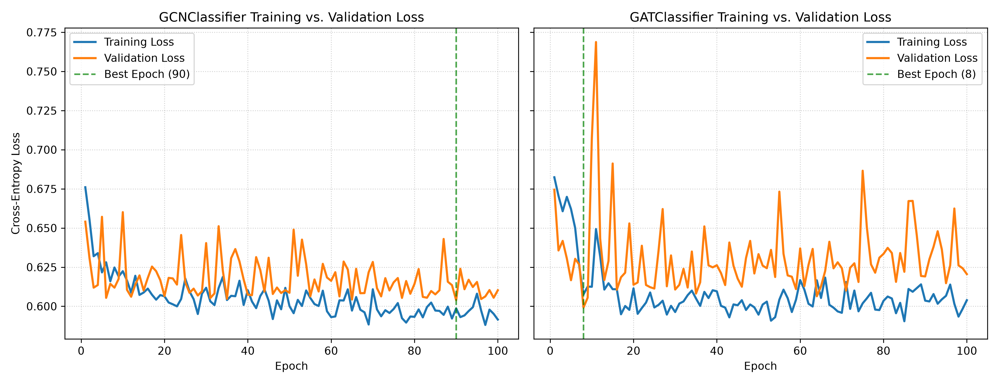

# Homework 6: Graph Neural Networks on PROTEINS

## Setup and Installation

To set up the environment and run the code, note that if the pip installation doesn't work you will need to use the python commands:

```bash
conda create -n env_csci4425 python=3.12 -y
conda activate env_csci4425
conda install numpy matplotlib scikit-learn -y
conda install pytorch torchvision torchaudio -c pytorch -y
______________________________
pip install torch  
pip install torch-geometric
_________________________________
pip install matplotlib scikit-learn
pip install scikit-learn                           
________________________________
python -m pip install scikit-learn
python -m pip install torch_geometric
________________________________

python hw6.py

---


## Part 1: Data Loading and Exploration

### Dataset Summary
* **Dataset:** `PROTEINS` (from PyTorch Geometric `TUDataset`)
* **Total number of graphs:** 1,113
* **Number of classes:** 2 (Enzyme vs. Non-enzyme)
* **Number of node features:** 3
* **Average number of nodes per graph:** 39.06

### Inspection of First Graph (`dataset[0]`)
* **Graph object:** `Data(edge_index=[2, 162], x=[42, 3], y=[1])`
* **Node feature matrix (`x`) shape:** `torch.Size([42, 3])`
* **Edge index matrix (`edge_index`) shape:** `torch.Size([2, 162])`
* **Graph label (`y`):** `tensor([0])`

**Sample `x` and `edge_index` tensors (`dataset[0]`):**
```text
Node feature matrix x:
tensor([[1., 0., 0.],
        [1., 0., 0.],
        [1., 0., 0.],
        [1., 0., 0.],
        [1., 0., 0.],
        [1., 0., 0.],
        [1., 0., 0.],
        [1., 0., 0.],
        [1., 0., 0.],
        [1., 0., 0.],
        [1., 0., 0.],
        [1., 0., 0.],
        [1., 0., 0.],
        [1., 0., 0.],
        [1., 0., 0.],
        [1., 0., 0.],
        [1., 0., 0.],
        [1., 0., 0.],
        [1., 0., 0.],
        [1., 0., 0.],
        [1., 0., 0.],
        [1., 0., 0.],
        [0., 1., 0.],
        [0., 1., 0.],
        [0., 1., 0.],
        [0., 1., 0.],
        [0., 1., 0.],
        [0., 1., 0.],
        [0., 1., 0.],
        [0., 1., 0.],
        [0., 1., 0.],
        [0., 1., 0.],
        [0., 1., 0.],
        [0., 1., 0.],
        [0., 1., 0.],
        [0., 1., 0.],
        [0., 1., 0.],
        [0., 1., 0.],
        [0., 1., 0.],
        [0., 1., 0.],
        [0., 1., 0.],
        [0., 1., 0.]])

Edge index matrix edge_index:
tensor([[ 0,  0,  0,  1,  1,  1,  2,  2,  2,  3,  3,  3,  3,  3,  4,  4,  4,  4,
          4,  4,  5,  5,  5,  6,  6,  6,  7,  7,  7,  7,  8,  8,  8,  8,  8,  9,
          9,  9,  9,  9,  9, 10, 10, 10, 11, 11, 11, 12, 12, 12, 13, 13, 13, 13,
         14, 14, 14, 14, 15, 15, 15, 16, 16, 16, 16, 17, 17, 17, 18, 18, 18, 18,
         19, 19, 19, 19, 19, 19, 19, 19, 20, 20, 20, 21, 21, 21, 22, 22, 22, 22,
         23, 23, 23, 23, 23, 24, 24, 24, 25, 25, 25, 26, 26, 26, 27, 27, 27, 28,
         28, 28, 29, 29, 29, 30, 30, 30, 31, 31, 31, 31, 31, 31, 32, 32, 32, 32,
         33, 33, 33, 33, 33, 34, 34, 34, 34, 35, 35, 35, 35, 36, 36, 36, 37, 37,
         37, 38, 38, 38, 38, 39, 39, 39, 39, 40, 40, 40, 41, 41, 41, 41, 41, 41],
        [11, 22, 32, 23, 31, 41, 24, 29, 34,  4, 28, 29, 38, 39,  3, 14, 28, 29,
         38, 39,  6,  7, 26,  5,  7,  8,  5,  6, 19, 25,  6,  9, 10, 25, 35,  8,
         10, 19, 21, 25, 35,  8,  9, 20,  0, 22, 32, 31, 33, 41, 14, 15, 34, 39,
          4, 13, 15, 39, 13, 14, 38, 17, 18, 19, 36, 16, 18, 19, 16, 17, 19, 35,
          7,  9, 16, 17, 18, 20, 21, 35, 10, 19, 21,  9, 19, 20,  0, 11, 30, 40,
          1, 24, 31, 34, 41,  2, 23, 33,  7,  8,  9,  5, 27, 37, 26, 28, 36,  3,
          4, 27,  2,  3,  4, 22, 31, 32,  1, 12, 23, 30, 33, 41,  0, 11, 30, 40,
         12, 24, 31, 34, 41,  2, 13, 23, 33,  8,  9, 18, 19, 16, 27, 37, 26, 36,
         38,  3,  4, 15, 37,  3,  4, 13, 14, 22, 32, 41,  1, 12, 23, 31, 33, 40]])
```

---

## Part 2: Data Preprocessing

The dataset was split at the graph level into **70% training**, **10% validation**, and **20% test** sets using stratified sampling (`sklearn.model_selection.train_test_split`) with **`random_state=0`** so that no graph appears in more than one split:

| Split | Target Proportion | Actual Graph Count | Actual Percentage |
| :--- | :---: | :---: | :---: |
| **Training Set** | 70% | 778 | 69.9% |
| **Validation Set** | 10% | 112 | 10.1% |
| **Test Set** | 20% | 223 | 20.0% |
| **Total** | **100%** | **1,113** | **100.0%** |

---

## Part 3 & Part 4: Checkpoint Selection and Held-Out Test Evaluation

Both models were trained for 100 epochs (`batch_size=32`, `hidden_channels=64`, `Adam` optimizer with `lr=0.01`, and `CrossEntropyLoss`). Model checkpoints were selected strictly using the lowest validation loss, and evaluated once on the held-out test set:

### Checkpoint Selection Summary
* **GCNClassifier:** Best Validation Loss = **`0.6039`** at **Epoch 90**
* **GATClassifier:** Best Validation Loss = **`0.5992`** at **Epoch 8**

### Test-Set Performance Comparison

| Model | Best Epoch | Lowest Val Loss | Accuracy | Precision | Recall | F1-Score |
| :--- | :---: | :---: | :---: | :---: | :---: | :---: |
| **GCNClassifier** | 90 | 0.6039 | **0.7040** | **0.6622** | **0.5444** | **0.5976** |
| **GATClassifier** | 8 | **0.5992** | 0.6457 | 0.6038 | 0.3556 | 0.4476 |

---

## Part 5: Analysis and Interpretation

### Training and Validation Loss Curves


### Discussion
* **Loss Progression Over Time:** For `GCNClassifier`, both the training and validation cross-entropy losses remain within the `0.60` to `0.675` range after the initial drop, with the training loss staying consistently below the validation loss and following a much smoother trajectory. `GATClassifier` exhibits a similar overall loss range, but its validation curve is noticeably more volatile and displays a sharp outlier spike around Epoch 10 (`0.7073`) before settling into wider fluctuations between `0.61` and `0.64`.
* **Overfitting and Stability:** `GCNClassifier` trains more steadily and shows minimal overfitting—its validation loss gradually trends downward alongside training loss, reaching its lowest value (`0.6039`) late in training at **Epoch 90**. Conversely, `GATClassifier` reaches its minimum validation loss (`0.5992`) very early at **Epoch 8**, after which validation loss drifts upward and fluctuates while training loss stays flat around `0.60`, indicating early overfitting and sensitivity to multi-head attention updates on small graphs.
* **Overall Test-Set Comparison:** Although `GATClassifier` achieved a slightly lower single-epoch validation loss at Epoch 8 (`0.5992` vs. `0.6039`), that early checkpoint underfit the positive class on unseen graphs (yielding a low recall of `0.3556`). **GCNClassifier** generalized substantially better on the held-out test set, outperforming GAT across every evaluation metric—achieving **70.40% accuracy** (+5.83%) and an **F1-score of 0.5976** (+0.1500).

## AI Acknowledgement
* this project was made with gemini as well as used for proof reading the report, I made sure to leave comments on the code in case there is any confusion