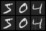
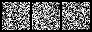
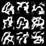
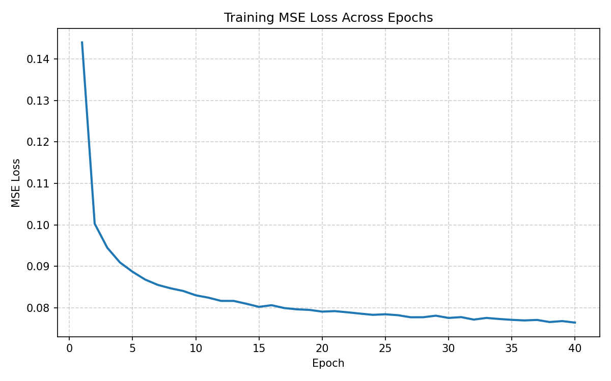

# Module 6: Simple Diffusion Model on MNIST

*Note on Generative AI Usage: Used Gemini to assist with structuring code snippets, debugging environment setup, and formatting documentation. All code was executed, tested, and verified independently.*

---

## Setup & Execution Commands

### 1. Environment Setup
Using Python 3.12 with a virtual environment (`venv`) and CUDA-enabled PyTorch:

```powershell
# Create and activate virtual environment (from deeplearning/homework7)
python -m venv venv
.\venv\Scripts\Activate.ps1

# Install required packages
pip install numpy==2.4.1 matplotlib==3.10.8 pandas==2.3.3 scikit-learn==1.8.0
pip install torch==2.5.1 torchvision==0.20.1 torchaudio==2.5.1 --index-url [https://download.pytorch.org/whl/cu121](https://download.pytorch.org/whl/cu121)
```

*(Alternatively, using Conda:)*
```bash
conda create -n env_csci4425 python=3.12.2 -y
conda activate env_csci4425
conda install numpy=2.4.1 matplotlib=3.10.8 pandas=2.3.3 scikit-learn=1.8.0 -y
conda install -c conda-forge scikit-datasets=0.2.5 -y
conda install pytorch=2.5.1 torchvision=0.20.1 torchaudio=2.5.1 -y
```

### 2. Running the Code
Run the scripts from the parent directory (`deeplearning/`) so package imports (`homework7.*`) resolve properly:

```powershell
# Step 1: Download the MNIST dataset into homework7/data/
python .\homework7\0_download_mnist.py

# Step 2: Explore data, demonstrate forward noise addition, and train the diffusion model
python -m homework7.1_train_simple_diffusion

# Step 3: Load trained checkpoint and run reverse diffusion inference
python -m homework7.2_inference_simple_diffusion
```

---

## Part 1: Data Loading and Exploration

After downloading MNIST using `0_download_mnist.py`, the training dataset is loaded via `torchvision.datasets.MNIST(..., train=True, download=False)` and normalized to `[-1, 1]` using `transforms.Normalize((0.5,), (0.5,))`.

* **Training dataset size (`len(dataset)`):** `60,000` samples (plus `10,000` test samples)
* **Single image shape (`dataset[0][0].shape`):** `torch.Size([1, 28, 28])` (1 grayscale channel, $28 \times 28$ resolution)

### First 3 Training Images (`out/part1_first_three_clean.png`)


---

## Part 2: Demonstrate Noise Adding (Forward Diffusion)

Using `SimpleNoiseScheduler` (`num_steps=200`, `beta_start=1e-4`, `beta_end=0.02`), random Gaussian noise $\epsilon \sim \mathcal{N}(0, I)$ was sampled with `torch.randn_like()` and applied to the first 3 images at timesteps `t = 2`, `t = 10`, and `t = 20` via `scheduler.add_noise()`:

$$x_t = \sqrt{\bar{\alpha}_t}\,x_0 + \sqrt{1 - \bar{\alpha}_t}\,\epsilon$$

### Clean vs. Noisy Comparison (`out/part2_noisy_comparison.png`)
* **Top row:** Original clean training digits (`t = 0`)
* **Bottom row:** Noisy digits at `t = 2` (left), `t = 10` (center), and `t = 20` (right)



As the diffusion timestep $t$ increases, $\bar{\alpha}_t$ decays, progressively adding Gaussian noise that obscures the clean digit edges while still preserving underlying structure at early timesteps.

---

## Part 3: Model Architecture and Training

### Model Architecture (`models/cnn.py`)
`SimpleCNN` is a 3-layer convolutional network that takes a noisy `(B, 1, 28, 28)` image tensor and outputs the predicted noise of identical shape:
1. `nn.Conv2d(1, 256, kernel_size=3, padding=1)` + `nn.ReLU()`
2. `nn.Conv2d(256, 256, kernel_size=3, padding=1)` + `nn.ReLU()`
3. `nn.Conv2d(256, 1, kernel_size=3, padding=1)`

### Training Configuration (`1_train_simple_diffusion.py`)
* **Device:** CUDA GPU (`cuda`)
* **Loss Function:** `nn.MSELoss()` comparing predicted noise $\hat{\epsilon}_\theta(x_t)$ against true Gaussian noise $\epsilon$
* **Optimizer:** `torch.optim.Adam` with learning rate `1e-3`
* **Hyperparameters:** `BATCH_SIZE = 128`, `EPOCHS = 40`, `HIDDEN_CHANNELS = 256`, `NUM_STEPS = 200`, `BETA_START = 1e-4`, `BETA_END = 0.02`
* **Outputs:** Trained checkpoint saved to `data/simple_cnn_diffusion.pth` and per-epoch loss log saved to `out/loss_history.csv`.

---

## Part 4: Inference and Reverse Diffusion

During inference (`2_inference_simple_diffusion.py`), the trained `SimpleCNN` weights and `SimpleNoiseScheduler` parameters (`num_steps`, `beta_start`, `beta_end`) are restored from `data/simple_cnn_diffusion.pth`. Starting from pure Gaussian noise $x_T \sim \mathcal{N}(0, I)$, the model iteratively denoises the tensor backward from $t = T - 1$ down to $0$ using `scheduler.sample_prev_step(images, timestep, predicted_noise)`.

### Initial 3 Random Noise Images (`out/starting_noise_3.png`)


### Final Generated Images from 3 Start Points (`out/generated_from_3_noise.png`)


### 3x3 Grid of Generated Samples (`out/generated_grid_3x3.png`)


---

## Part 5: Analysis and Interpretation

### 1. Does the model learn the denoising task successfully?
Yes. The training MSE loss drops sharply during early epochs—from **0.143996** at Epoch 1 to **0.083033** at Epoch 10—and steadily converges to **0.076457** by Epoch 40. During reverse diffusion, the network removes high-frequency Gaussian static from pure noise inputs and synthesizes coherent bright foreground strokes against dark backgrounds. Because `SimpleCNN` uses three $3 \times 3$ convolutional layers without U-Net downsampling/skip connections or explicit timestep embeddings ($t$), its spatial receptive field is local ($7 \times 7$) and it estimates noise uniformly across timesteps, producing softer, more abstract digit shapes than a full timestep-conditioned U-Net.

### 2. Training Loss Curve and Stability (`out/part5_training_loss.png`)


* **Loss Progression:** The MSE loss drops steeply across the first 5 epochs (`0.143996` $\rightarrow$ `0.088703`), followed by smooth, gradual convergence from Epoch 6 (`0.086823`) through Epoch 40 (`0.076457`).
* **Training Stability:** Training is stable across all 40 epochs with no divergence or sudden spikes. Minor epoch-to-epoch fluctuations ($\pm 0.0004$) reflect stochastic sampling of fresh Gaussian noise $\epsilon$ and uniform random timesteps $t \in [0, 200)$ on every batch.

### 3. Comparison of Clean, Noisy, and Generated Images
* **Clean Images:** Crisp, high-contrast handwritten digits (`5`, `0`, `4`) centered on uniform dark backgrounds.
* **Noisy Images:** Progressively degraded versions of the clean digits as $t$ increases (`2` $\rightarrow$ `10` $\rightarrow$ `20`), demonstrating how the forward process gradually corrupts structured pixel intensity toward isotropic Gaussian noise.
* **Generated Images:** Starting from unstructured Gaussian noise (`starting_noise_3.png`), the reverse diffusion trajectory suppresses background noise and constructs continuous foreground strokes (`generated_from_3_noise.png` and `generated_grid_3x3.png`), illustrating how iterative noise prediction enables generative sampling from pure noise.